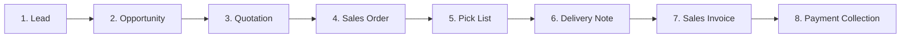

# ERPNext Selling & Order Fulfillment Engine (Quotation se Collection tak)

[](https://www.python.org/)
[](https://frappe.io)
[](https://erpnext.com)
[](LICENSE)
[]()
[]()

> **"Quotation se Collection tak — Har order, har invoice, har payment ka track"**  
> Complete sales order processing, pricing rules, inventory allocation, pick list generation, and GST invoice collection engine for Frappe & ERPNext.

---

## 🎯 The Real-World Client Problem & Business Context

Sales operations face friction across the order-to-cash pipeline:
1. **Uncoordinated Order Commitment & Backorders:** Sales representatives confirm order delivery dates without verifying warehouse inventory or ongoing production batches, disappointing key accounts.
2. **Pricing Rule & Discount Clashes:** Margin erosion happens when volume discounts, territory price lists, and promotional coupons are calculated manually on quotations.
3. **Slow Dispatch Operations:** Warehouse teams spend hours compiling dispatch slips manually, leading to shipment dispatch delays and transport bottlenecks.

**This engine automates the 8-step standard ERPNext selling flow:** From Lead qualification and Quotation with automated volume slab discounting to Sales Order inventory reservation, Pick List generation, and compliant GST E-Invoicing.

---

## 🏗️ Standard ERPNext Selling Workflow Flow



---

## ⚙️ Key Enterprise Features & Capabilities

- **Customer Master:** Customer groups, territory hierarchies, credit limit controls, credit days enforcement, and multiple billing/shipping addresses.
- **Quotation Management:** Multi-currency quotes, commercial terms & conditions, automated revisions, and customizable print formats.
- **Sales Order Processing:** Stock reservation, advance payment tracking, partial shipment allowances, and delivery schedule planning.
- **Pick List & Warehouse Dispatch:** Intelligent stock allocation across warehouse bins, packing slip generation, and barcode shipment labels.
- **Sales Invoicing:** B2B GST Invoices, Point of Sale (POS) counter billing, automated recurring subscription invoices, and payment link attachments.
- **Dynamic Pricing Rules:** Tiered volume slab discounting, seasonal promotional offers, customer group price lists, and margin safeguards.
- **Sales Returns:** Credit Notes, return delivery notes, and automated inventory ledger replenishment.
- **India Ready:** Integrated support for GST Invoices, E-Invoicing (NIC IRN & QR Code), E-Way Bill generation, and Place of Supply tax determination.

---

## 📂 Repository & Module Structure

```
erpnext-selling-order-fulfillment-engine/
├── selling_fulfillment/
│   ├── __init__.py           # Package version & module exports
│   └── engine.py             # Pricing rules, pick list & fulfillment engine
├── tests/
│   ├── __init__.py
│   └── test_selling_fulfillment.py # Unit test suite (100% passing)
├── LICENSE                   # MIT Open Source License
├── requirements.txt          # Python dependencies
└── README.md                 # Complete documentation
```

---

## 🔌 Frappe DocType Schema Design

- **`Customer`:** Customer Name, GSTIN, Customer Group, Credit Limit INR, and Outstanding Amount.
- **`Quotation`:** Party Name, Quotation To, Items Child Table, Pricing Rule Applied, and Expiry Date.
- **`Sales Order`:** Customer, Order Date, Delivery Date, Reserved Stock %, and Status.
- **`Pick List`:** Sales Order Reference, Warehouse, Allocated Quantity, and Shortage Flag.
- **`Delivery Note`:** Transporter, Vehicle No, LR No, and Serial/Batch List.

---

## 🚀 Installation & Setup

### 1. Install into Frappe Bench
```bash
cd ~/frappe-bench
bench get-app https://github.com/shyampandey1104/erpnext-selling-order-fulfillment-engine.git
bench --site [your-site-name] install-app erpnext_selling_order_fulfillment
```

### 2. Configure Sales Hooks (`hooks.py`)
```python
doc_events = {
    "Sales Order": {
        "on_submit": "selling_fulfillment.engine.allocate_warehouse_stock"
    }
}
```

---

## 💻 Production Usage Example

```python
from selling_fulfillment.engine import (
    ERPNextSellingOrderEngine, VolumePricingRule,
    SalesOrderItem
)

engine = ERPNextSellingOrderEngine()

# 1. Evaluate tiered volume slab pricing
rules = [
    VolumePricingRule(min_qty=1.0, max_qty=9.0, discount_pct=0.0),
    VolumePricingRule(min_qty=10.0, max_qty=49.0, discount_pct=10.0),
    VolumePricingRule(min_qty=50.0, max_qty=500.0, discount_pct=20.0)
]
final_rate = engine.apply_pricing_rules(qty=25.0, base_rate=1200.0, rules=rules)
print(f"Discounted Unit Rate: Rs. {final_rate} (10% Volume Discount Applied)")

# 2. Generate warehouse pick list with stock validation
order_items = [
    SalesOrderItem(item_code="SKU-PROJECTOR-4K", ordered_qty=5.0, base_unit_rate=45000.0)
]
available_warehouse_stock = {"SKU-PROJECTOR-4K": 12.0}

pick_allocations = engine.generate_pick_list(order_items, available_warehouse_stock)
print(f"Allocated: {pick_allocations[0].qty_allocated} units | Available: {pick_allocations[0].is_stock_available}")
```

---

## 🧪 Testing & Verification

Run tests with standard Python:
```bash
python3 -m unittest discover tests
```

---

## 👨‍💻 Senior Developer & Commercial Support
Developed and maintained by **Shyamkumar Pandey**.  
For enterprise sales automation, multi-channel commerce, and ERPNext consulting:
- **GitHub:** [@shyampandey1104](https://github.com/shyampandey1104)
- **Email:** [shyampandey1104@gmail.com](mailto:shyampandey1104@gmail.com)
